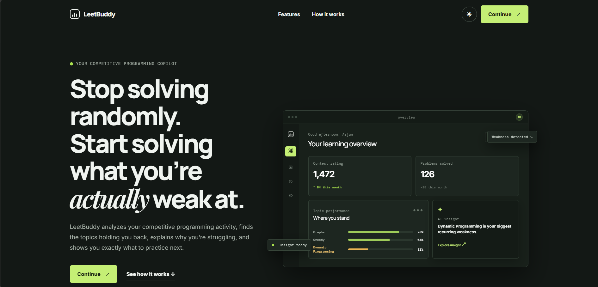

# Kanishk Sharma — Portfolio

<div align="center">

## Full-stack engineering × applied GenAI

An editorial-style portfolio for **Kanishk Sharma** — a 4th-year Computer Science student at VIT Bhopal building thoughtful web products, AI tools, and developer experiences.

[](https://myportfolio-mu-cyan-34.vercel.app)
[](https://github.com/kanishk3114S)
[](https://www.linkedin.com/in/kanishk-sharma-b0912735a)

<br />


</div>

<br />



## The idea

This portfolio is designed to feel like a calm, tactile workspace rather than a template dashboard. The visual system is built from a charcoal canvas, restrained yellow accents, typography-led layouts, subtle atmospheric imagery, and motion that supports navigation instead of competing with the work.

The page brings together:

- **Projects** — six full-stack and AI projects with filters, live previews, stack details, and architecture/data-flow views.
- **Engineering journey** — education, hackathons, certifications, and milestones in a scroll-linked timeline.
- **Algorithmic work** — 1,000+ solved problems, rating history, topic proficiency, and competitive programming metrics.
- **Skills** — a visual, categorized technology library backed by the central portfolio data store.
- **Contact** — a validated form endpoint with request limits and clear success/error states.

## At a glance

| | |
| --- | --- |
| **Name** | Kanishk Sharma |
| **Focus** | Full-stack web applications · applied GenAI · RAG systems |
| **Education** | B.Tech CSE, VIT Bhopal · 2023–2027 |
| **Academic score** | CGPA 8.34 |
| **Competitive programming** | 1,000+ problems · LeetCode Knight · peak rating 1883 |
| **Location** | India |

## Featured work

| Project | What it explores | Category |
| --- | --- | --- |
| [LeetBuddy](https://leet-buddy-six.vercel.app/) | Competitive programming analytics and an AI coding mentor | AI / RAG |
| [CricScript AI](https://cricscript-ai.onrender.com/) | Grounded match research and documentary script generation | AI / agents |
| [Engram](https://engram-teal.vercel.app/) | Persona-based journaling with long-term vector memory | AI / memory |
| [TruthLens](https://truuuthlens.vercel.app/) | Media claim verification with confidence and bias signals | Full-stack |
| [ProjectCamp](https://project-management-application-six.vercel.app/) | Team project management with RBAC and sprint velocity | Full-stack |
| **The Mega World** | Kalos Pokédex, 3D map exploration, and team-building tools | Full-stack |

Each project is represented in [`src/data/portfolioData.ts`](./src/data/portfolioData.ts), keeping copy, technologies, screenshots, and architecture details in one typed source of truth.

## Experience by design

<table>
  <tr>
    <td width="50%" valign="top">
      <h3>Ambient 3D</h3>
      A lightweight React Three Fiber canvas renders a deterministic 1,800-point atmospheric field behind the hero. It adds depth without turning the portfolio into a scene that distracts from the content.
    </td>
    <td width="50%" valign="top">
      <h3>Quiet interaction</h3>
      Framer Motion handles entrance transitions, project filtering, floating skill chips, modal states, and spring-like micro-interactions. Reduced-motion preferences are respected globally.
    </td>
  </tr>
  <tr>
    <td width="50%" valign="top">
      <h3>Useful detail</h3>
      Project cards open into architecture views with system patterns, nodes, and data flow — enough technical context to understand the work without burying the visitor in a case-study wall of text.
    </td>
    <td width="50%" valign="top">
      <h3>Built for scanning</h3>
      Clear section anchors, a scroll telemetry HUD, responsive layouts, high-contrast controls, semantic metadata, and a dark/light theme make the long-form page easy to navigate.
    </td>
  </tr>
</table>

## Tech stack

| Layer | Tools |
| --- | --- |
| **Framework** | Next.js 16 App Router, React 19, TypeScript |
| **Styling** | Tailwind CSS 4, custom CSS variables, responsive utilities |
| **Motion** | Framer Motion, CSS keyframes, magnetic pointer interactions |
| **3D** | Three.js, React Three Fiber, Drei |
| **UI** | Lucide React, Next Image, typed inline technology icons |
| **Forms & validation** | React Hook Form, Zod |
| **Theme** | next-themes with dark and light modes |
| **Deployment** | Vercel-ready Next.js build |

## Application flow

```text
Next.js App Router
        │
        ├── Root layout
        │     ├── Metadata + Open Graph
        │     ├── Person JSON-LD
        │     ├── Theme provider
        │     └── Custom cursor
        │
        ├── Home page
        │     ├── Hero + R3F atmospheric field
        │     ├── Journey timeline
        │     ├── Filterable project grid
        │     ├── Algorithmic vault
        │     ├── Skills arsenal
        │     ├── Achievements
        │     └── Contact form
        │
        └── POST /api/contact
              ├── JSON parsing
              ├── Zod validation
              ├── Per-IP in-memory rate limiting
              └── Server-side receipt response
```

The contact route currently validates and logs submissions server-side. It does not send email through a third-party provider yet, so no environment variables are required to run the project locally.

## Project structure

```text
.
├── public/
│   ├── images/
│   │   ├── profile/       # Profile image
│   │   ├── projects/      # Project preview images
│   │   └── themes/        # Atmospheric background artwork
│   └── resumes/           # Full-stack and GenAI PDF resumes
├── src/
│   ├── app/
│   │   ├── api/contact/   # Validated contact endpoint
│   │   ├── globals.css    # Theme tokens, grid, motion, accessibility
│   │   ├── layout.tsx     # Fonts, metadata, JSON-LD, providers
│   │   └── page.tsx       # Portfolio section composition
│   ├── components/
│   │   ├── 3d/            # React Three Fiber background
│   │   ├── layout/        # Navbar and footer
│   │   ├── sections/      # Main portfolio sections
│   │   └── ui/            # Reusable interaction and display primitives
│   ├── config/            # Theme asset registry
│   ├── context/           # Atmosphere state
│   └── data/              # Typed portfolio content
├── next.config.mjs
├── package.json
└── tsconfig.json
```

## Run locally

### Requirements

- Node.js 18.18+ (Node 20+ recommended)
- npm

### Install and start

```bash
git clone https://github.com/kanishk3114S/Portfolio-website.git
cd Portfolio-website
npm install
npm run dev
```

Open [http://localhost:3000](http://localhost:3000).

### Available scripts

```bash
npm run dev       # Start the development server
npm run lint      # Run ESLint
npm run build     # Create a production build
npm run start     # Serve the production build
```

## Deploy

The project is ready for a standard Vercel deployment:

1. Import the GitHub repository into [Vercel](https://vercel.com/new).
2. Keep the framework preset as **Next.js**.
3. Use the default install and build settings.
4. Deploy.

No environment variables are needed for the current version.

## Connect

| | |
| --- | --- |
| **Email** | [chesssynid@gmail.com](mailto:chesssynid@gmail.com) |
| **LinkedIn** | [kanishk-sharma-b0912735a](https://www.linkedin.com/in/kanishk-sharma-b0912735a) |
| **GitHub** | [kanishk3114S](https://github.com/kanishk3114S) |
| **LeetCode** | [KanishkSharma3114](https://leetcode.com/KanishkSharma3114) |
| **Codeforces** | [kanishk3114S](https://codeforces.com/profile/kanishk3114S) |

## License

This project is open source under the [MIT License](./LICENSE).

<div align="center">

<sub>Designed and built by Kanishk Sharma.</sub>

</div>
